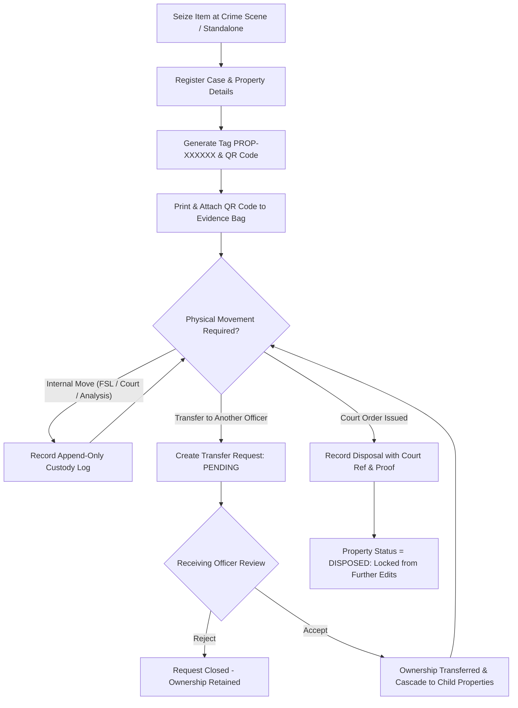
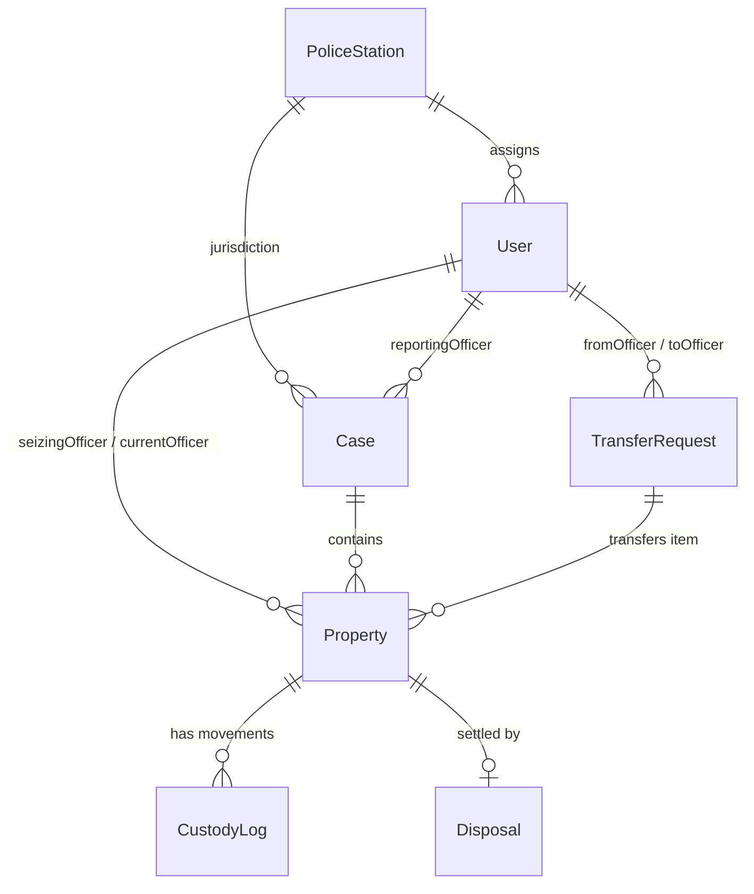

# 🏛️ E-Malkhana — Digital Evidence & Case Management System

> **Secure, transparent, and auditable evidence management designed for modern law enforcement.**

[](https://nextjs.org/)
[](https://react.js.org/)
[](https://www.typescriptlang.org/)
[](https://www.mongodb.com/)
[](https://next-auth.js.org/)
[](https://tailwindcss.com/)
[](https://cloudinary.com/)

---

## 📖 Table of Contents

- [Overview](#-overview)
- [Key Features](#-key-features)
- [Evidence Lifecycle & Workflow](#-evidence-lifecycle--workflow)
- [Role-Based Access Control (RBAC)](#-role-based-access-control-rbac)
- [System Architecture](#-system-architecture)
- [Database Schema & Models](#-database-schema--models)
- [Directory Structure](#-directory-structure)
- [Getting Started](#-getting-started)
  - [Prerequisites](#prerequisites)
  - [Environment Configuration](#environment-configuration)
  - [Installation & Setup](#installation--setup)
  - [Admin Bootstrapping](#admin-bootstrapping)
- [Core Workflows & Technical Highlights](#-core-workflows--technical-highlights)
- [Future Enhancements & Roadmap](#-future-enhancements--roadmap)

---

## 🔍 Overview

A **Malkhana** is the designated police property and evidence room where items seized during criminal investigations (*muddamal*) are securely stored. Traditional physical paper registers are prone to wear, misplacement, unauthorized record alteration, and lack verifiable custody accountability.

**E-Malkhana** digitizes and modernizes the complete evidence management pipeline:
- **End-to-End Chain of Custody:** Immutable, append-only logs track every physical movement from initial seizure to final court-mandated disposal.
- **Automated QR Identification:** Dynamic QR code generation stamped on physical evidence bags for instant scanning and verification.
- **Two-Phase Custody Handover:** Consent-based transfer mechanism ensuring physical accountability before digital ownership updates.
- **Scoped Database-Level Authorization:** Multi-tier RBAC ensuring officers only access records relevant to their assigned duties.

---

## ✨ Key Features

| Category | Feature | Description |
|---|---|---|
| 🏷️ **Tagging & QR** | **Automated Tagging (`PROP-XXXXXX`)** | Auto-generates unique human-readable property tags via Mongoose pre-save hooks and stores printable QR data URLs. |
| 🛡️ **Chain of Custody** | **Append-Only Audit Trail** | Every movement (to Court, FSL, Storage, Analysis) writes an immutable custody log verified against the authenticated user's session. |
| 🔄 **Transfers** | **Two-Phase Transfer Verification** | Sender initiates transfer request (`PENDING`) $\rightarrow$ Receiver reviews and explicitly `ACCEPTS` or `REJECTS`. |
| ⚡ **Case Linking** | **Automatic Property Cascade** | Accepting a case transfer automatically updates and cascades custody for all attached property items. |
| ⚖️ **Disposal** | **Court-Mandated Evidence Disposal** | Disposals (`RETURNED`, `DESTROYED`, `AUCTIONED`, `COURT_CUSTODY`) require court order references, documentation, and lock property records permanently. |
| 🚨 **Alerts & Reports** | **Aging Evidence & Pending Alerts** | Highlights long-pending cases (>7 days) requiring investigation review; printable formal police reports and PDF exports. |
| ☁️ **Media Management** | **Cloudinary CDN Integration** | High-resolution seizure photos and court-order PDFs stored securely off-database with automated size and format optimization. |

---

## 🔄 Evidence Lifecycle & Workflow



---

## 👥 Role-Based Access Control (RBAC)

The system defines 3 distinct user tiers. Access control is enforced **at the database query level** (row-level security) rather than merely hiding client-side UI elements:

| Feature / Capability | 👑 ADMIN | 👮 SHO (Station House Officer) | 👮‍♂️ OFFICER (Investigating Officer) |
|---|:---:|:---:|:---:|
| **Police Station Management** | ✅ Full Access | ❌ Read Only | ❌ Read Only |
| **Officer / User Management** | ✅ Full Access | ❌ Read Only | ❌ Read Only |
| **All Station Evidence Visibility** | ✅ Unrestricted | 🔍 Station Scoped | 🔒 Own / Transferred Items Only |
| **Case Registration & Linking** | ✅ | ✅ | ✅ |
| **Property Seizure Entry & QR Generation** | ✅ | ✅ | ✅ |
| **Custody Movement Logging** | ✅ | ✅ | ✅ |
| **Property Transfer Creation** | ❌ *(Prevented)* | ✅ | ✅ |
| **Accept / Reject Transfer Requests** | ❌ | ✅ *(If Recipient)* | ✅ *(If Recipient)* |
| **Final Property Disposal** | ✅ | ✅ | ✅ |
| **View Aging Alerts & Reports** | ✅ | ✅ | ✅ |

---

## 🏗️ System Architecture

E-Malkhana is built as a unified full-stack web application powered by the **Next.js 16 App Router**:

```
┌────────────────────────────────────────────────────────┐
│                   Next.js App Router                   │
├────────────────────────────┬───────────────────────────┤
│    React Server Components │ Server Actions & REST API │
│  (Direct Mongo Read Queries│ (Type-Safe DB Mutations & │
│      without API latency)  │     Cloudinary Uploads)   │
├────────────────────────────┴───────────────────────────┤
│                   Auth.js (JWT Strategy)               │
│        (Role & Station identity injected in token)     │
├────────────────────────────────────────────────────────┤
│                    Mongoose ODM Layer                  │
│       (7 Schemas, Compound Indexes, Pre-Hooks)         │
├────────────────────────────┬───────────────────────────┤
│     MongoDB Database       │     Cloudinary Media CDN  │
└────────────────────────────┴───────────────────────────┘
```

---

## 🗄️ Database Schema & Models

The application manages 7 interconnected Mongoose models:



1. **`User`**: System credentials, `role` (`ADMIN`, `SHO`, `OFFICER`), unique `officerId`, police station reference, and account `status` (`ACTIVE`, `SUSPENDED`).
2. **`PoliceStation`**: Station details, `sarkariId`, district, contact phone, and address. Compound unique index on `(name, district)`.
3. **`Case`**: FIR records, `caseNumber` (`CRIME_NO/YEAR`), `crimeType`, `actAndLaw` arrays, `section` arrays, and investigating officer assignment. Compound unique index on `(crimeNumber, crimeYear)`.
4. **`Property`**: Seized evidence items (`CASE_RELATED`, `KURKI`, `UNCLAIMED`), description, quantity, units, storage location, item photos, QR code data, and `currentOfficer` pointer.
5. **`CustodyLog`**: Append-only movement records containing `fromOfficer`, `toOfficer`, `fromLocation`, `toLocation`, `purpose` (`COURT`, `FSL`, `STORAGE`, `ANALYSIS`, etc.), action, and verified handler `userId`.
6. **`Disposal`**: Court-mandated disposal records (`RETURNED`, `DESTROYED`, `AUCTIONED`, `COURT_CUSTODY`), court order reference number, disposal date, authority, proof photos, and order PDF URL.
7. **`TransferRequest`**: Polymorphic multi-item transfer queue between officers with individual status (`PENDING`, `ACCEPTED`, `REJECTED`).

---

## 📁 Directory Structure

```plaintext
e-malkhana/
├── app/
│   ├── (auth)/login/             # Officer & Admin authentication page
│   ├── addcase/                  # Quick case registration route
│   ├── alerts/                   # Long-pending cases alert dashboard
│   ├── api/                      # REST Route Handlers
│   │   ├── alerts/               # Long-pending case queries
│   │   ├── auth/[...nextauth]/   # NextAuth authentication endpoint
│   │   ├── case-pdf/             # Case summary generation
│   │   ├── cases/                # Case CRUD and filter endpoints
│   │   ├── custody/              # Custody movement logging API
│   │   ├── disposal/             # Disposal handling API
│   │   ├── officers/             # Station officer directory API
│   │   ├── police-stations/      # Station management API
│   │   ├── properties/           # Property lookup & filtering
│   │   ├── seed/                 # Initial system admin bootstrap endpoint
│   │   ├── trasferProperty/      # Transfer request handling API
│   │   ├── upload/               # Cloudinary secure image/PDF upload handler
│   │   └── users/                # Officer account management
│   ├── cases/                    # Case listing, detail, and management views
│   ├── dashboard/                # Main analytics and case/evidence summary
│   ├── police-stations/          # Police station directory (Admin only)
│   ├── properties/               # Property directory, QR view, and custody views
│   ├── reports/                  # Malkhana printable reports & analytics
│   ├── transferProperty/         # Initiate property/case transfer requests
│   ├── transferPropertyLog/      # Incoming & outgoing transfer history
│   ├── users/                    # User management & account provisioning
│   ├── layout.tsx                # Root layout with session provider & navigation
│   └── page.tsx                  # Public landing / portal overview
├── components/                   # Reusable UI & Client Form Components
│   ├── CaseForm.tsx              # Dynamic case registration with multi-act selection
│   ├── CustodyForm.tsx           # Movement & chain-of-custody logging modal
│   ├── CustodyLogsList.tsx       # Interactive custody timeline component
│   ├── DisposalForm.tsx          # Disposal recording modal with file uploads
│   ├── Header.tsx                # Top navigation bar with active session state
│   ├── LinkPropertyForm.tsx      # Form to attach standalone property to a case
│   ├── LoginForm.tsx             # Secure login form with validation
│   ├── PoliceStationForm.tsx     # Police station provisioning form
│   ├── PropertyForm.tsx          # Evidence seizure registration form with image upload
│   └── UserForm.tsx              # Officer account creation form
├── lib/                          # Core server utilities & configuration
│   ├── action-response.ts        # Typed OOP response wrapper (ActionResponse<T>)
│   ├── async-handler.ts          # Centralized error-handling higher-order function
│   ├── auth.ts                   # NextAuth JWT options & credentials provider
│   ├── cloudinary.ts             # Cloudinary SDK client configuration
│   └── db.ts                     # Cached MongoDB connection pool manager
├── models/                       # Mongoose Data Models & Schemas
└── types/                        # TypeScript type definitions (NextAuth session types)
```

---

## 🚀 Getting Started

### Prerequisites

- **Node.js**: `v18.18+` or `v20+` recommended
- **npm** or **pnpm** / **yarn**
- **MongoDB**: Local instance or [MongoDB Atlas](https://www.mongodb.com/atlas) cluster
- **Cloudinary Account**: For evidence photo and document storage

---

### Environment Configuration

Create a `.env.local` file in the project root:

```env
# MongoDB Connection String
MONGODB_URI=mongodb+srv://<username>:<password>@cluster0.mongodb.net/case-management?retryWrites=true&w=majority

# NextAuth Configuration
NEXTAUTH_URL=http://localhost:3000
NEXTAUTH_SECRET=your-secure-random-secret-key-at-least-32-chars

# Cloudinary Storage Configuration
CLOUDINARY_CLOUD_NAME=your_cloudinary_cloud_name
CLOUDINARY_API_KEY=your_cloudinary_api_key
CLOUDINARY_API_SECRET=your_cloudinary_api_secret

# Initial Admin Bootstrap Credentials (Used by /api/seed)
BOOTSTRAP_ADMIN_USERNAME=admin
BOOTSTRAP_ADMIN_EMAIL=admin@police.gov.in
BOOTSTRAP_ADMIN_NAME="Super Administrator"
BOOTSTRAP_ADMIN_PASSWORD=YourStrongAdminPassword123!
BOOTSTRAP_ADMIN_OFFICER_ID=HQ-ADM-001
BOOTSTRAP_ADMIN_STATION=HQ_STATION_ID_OR_NAME
```

> **Tip:** You can generate a secure `NEXTAUTH_SECRET` using:
> ```bash
> openssl rand -base64 32
> ```

---

### Installation & Setup

1. **Clone the repository:**
   ```bash
   git clone https://github.com/aditraj24/e_malkhana.git
   cd e_malkhana
   ```

2. **Install dependencies:**
   ```bash
   npm install
   ```

3. **Start the development server:**
   ```bash
   npm run dev
   ```

4. **Access the application:**
   Open [http://localhost:3000](http://localhost:3000) in your browser.

---

### Admin Bootstrapping

On first setup, create the root administrator account:

1. Ensure the `BOOTSTRAP_ADMIN_*` variables are defined in `.env.local`.
2. Send a `POST` request to the seed endpoint:
   ```bash
   curl -X POST http://localhost:3000/api/seed
   ```
3. Once seeded, log in at [http://localhost:3000/login](http://localhost:3000/login) using your bootstrap credentials.

---

## 💡 Core Workflows & Technical Highlights

### 1. Robust Query-Level Authorization
Instead of filtering records in frontend components after retrieval, non-admin queries are strictly scoped in MongoDB:
```ts
// Property query scoping
const filter = isAdmin ? {} : { currentOfficer: userId };

// Case query scoping: Owned cases + Cases containing properties in officer's custody
const ownedCases = await Case.find({
  $or: [{ reportingOfficer: userId }, { reportedOfficer: userId }]
});
const transferredProps = await Property.find({ currentOfficer: userId });
const allowedIds = new Set([...ownedCases.map(c => c._id), ...transferredProps.map(p => p.caseId)]);
```

### 2. OOP Design Patterns: `ActionResponse<T>` & `asyncHandler`
Server actions encapsulate return values and errors uniformly using a generic class pattern:
```ts
export default class ActionResponse<T> {
  public readonly success: boolean;
  private readonly _data: T | null;
  public readonly message: string;

  static success<T>(data: T, message = "Success") { ... }
  static error(message: string) { ... }
}
```

### 3. Serverless Database Connection Pooling
Prevents MongoDB connection exhaustion during hot-reloads and serverless function executions by persisting the connection across invocations on `globalThis`.

---

## 🔮 Future Enhancements & Roadmap

- [ ] **Cryptographic Hash-Chaining:** Link sequential `CustodyLog` entries via SHA-256 (`blockchainHash`) to make tampering mathematically detectable.
- [ ] **Multi-Document Mongo Transactions:** Wrap multi-property transfers inside replica-set sessions (`session.withTransaction`).
- [ ] **Full-Text Atlas Search:** Replace standard regex matching with tokenized indexing for instant lookup across FIR descriptions and property remarks.
- [ ] **Real-Time Push Notifications:** WebSocket/SSE alerts for urgent transfer requests and critical custody movements.

---

## 📄 License

This project is developed for police evidence management modernization. Distributed under the **MIT License**.